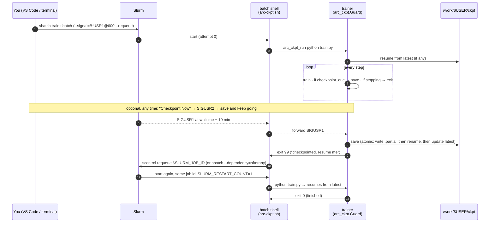

# Checkpoint before the walltime: signalling training jobs on Arc

When a Slurm job reaches its time limit, Slurm doesn't wait for your epoch to finish. It sends `SIGTERM`, and after `KillWait` seconds (commonly 30) it sends `SIGKILL`. A model with 30 GB of optimizer state can't be written to Lustre in 30 seconds. Anything since your last save is lost, and the job shows as `TIMEOUT`.

This kit gives the training process an earlier warning that is hard to miss. Whoever raises the warning (Slurm, you in a terminal, or VS Code), your training loop sees the same two questions:

```python
if guard.checkpoint_due: save()      # write a checkpoint now
if guard.stopping:       guard.exit()  # leave cleanly; the job resubmits itself
```

| File | What it is |
|---|---|
| [`arc_ckpt.py`](arc_ckpt.py) | Python guard, standard library only. Turns signals, the walltime, and request files into the `checkpoint_due` / `stopping` flags, and writes a status file. Includes adapters for the Hugging Face Trainer and an atomic save helper. |
| [`arc-ckpt.sh`](arc-ckpt.sh) | Bash, sourced in your sbatch script. Forwards signals from the batch shell to the trainer, then requeues or resubmits when the trainer exits with 99. It also provides flags for pure-bash loops. |
| [`train.sbatch`](train.sbatch) | A resumable job template: `--signal=B:USR1@600`, `--requeue`, checkpoints under `/work`. |
| [`example_train.py`](example_train.py) | A minimal PyTorch loop showing the four lines you add. |
| `arc ckpt …` / `arc why …` | Commands in the [`arc`](../arc) CLI: ask a running job to save or stop, read its status, and explain how a job ended. |
| VS Code: **Checkpoint Now**, **Checkpoint & Stop…**, **Checkpoint Status**, plus a walltime warning | The extension wraps the same commands (job right-click in **My Jobs**). |

Installation: **Arc: Run Setup → Prepare Arc** (or `bash setup-on-arc.sh`) copies the three helper files to `~/.local/lib/arc/` and creates `~/.arc/ckpt/`, `/work/$USER/ckpt/` and `/work/$USER/logs/`.

---

## 1. The flow



The same flow in plain text, for a 72 h GPU job:

```
t=0          sbatch train.sbatch            → trainer starts, loads /work/$USER/ckpt/<run>/latest if present
t=every 1 h  ARC_CKPT_EVERY=3600            → periodic save (insurance against node failure)
t=71:50      Slurm: SIGUSR1 to batch shell  → forwarded → guard.stopping = True
             trainer finishes its step, saves, exits 99
             arc_ckpt_finish 99             → scontrol requeue → job PENDING again
t=72:00      (walltime: nothing left to kill)
…queue…      same job id starts again       → resumes from the checkpoint
```

### Three ways to raise the warning

| Who | How | Signal / file | Guard reacts with |
|---|---|---|---|
| **Slurm, automatically** | `#SBATCH --signal=B:USR1@600` | `SIGUSR1` to the batch shell, which forwards it | `stopping` → save → exit 99 → resubmit |
| **Guard, automatically** | No `--signal`? At start-up the guard reads the end time (`SLURM_JOB_END_TIME` or `squeue %L`) | — | `stopping` once fewer than `ARC_CKPT_MARGIN` seconds remain |
| **You, terminal** | `arc ckpt save [JOBID]` | `scancel --full --signal=USR2` | `checkpoint_due` → save, keep training |
| | `arc ckpt stop [JOBID]` | `scancel --full --signal=USR1` | save → exit 99 → resubmit |
| | `arc ckpt stop JOBID --no-resume` | `.noresume` file + `USR1` | save → exit 0, no resubmit |
| **You, VS Code** | Right-click a running job → **Checkpoint Now** / **Checkpoint & Stop…** | same as above | same |
| | Warning *"job X reaches its walltime in 18 min"* (`arc.checkpointWarnMinutes`, default 20) | buttons run the commands above | |
| **Slurm, final** | Time limit or `scancel` | `SIGTERM`, then `SIGKILL` after `KillWait` | `stopping` and `final`: save the smallest thing you can, fast |

`scancel --full` signals the batch shell and every step. It therefore reaches the trainer however it was launched: directly, under `srun`, or via `torchrun`. The guard ignores duplicate deliveries.

### The interactive case: training in a VS Code terminal on your node

When you've used **Arc: Start Session** and run `python train.py` in the node window's terminal, there's no sbatch and no `--signal`. The process isn't in a Slurm step, and that SSH session has no `SLURM_*` variables. The guard handles this case as follows:

- It finds its job by asking `squeue` which of your running jobs owns this node. Nodes are exclusive per user on Arc, so the answer is unique. That gives it the holder job's end time, and `stopping` turns on `ARC_CKPT_MARGIN` seconds before the end.
- VS Code's existing *"your node's job ends in 14 min"* warning now has a **Checkpoint training…** button. It, and **Checkpoint & Stop…** on the holder job, writes `~/.arc/ckpt/<jobid>.stop` instead of sending a signal. The guard checks for that file every 15 s.
- Nothing is resubmitted, because there's no batch script. Start a new session and re-run, and the trainer resumes from `latest`.

For anything longer than a working session, submit it as a batch job instead. It frees the node you're editing on, avoids the GPU-idle rule while you're typing, and gets automatic resubmission.

---

## 2. Quick start

```bash
# on Arc, once (or VS Code: Arc: Run Setup → Prepare Arc)
bash ~/arc-kit/remote/setup-on-arc.sh

# per project
cp ~/.local/lib/arc/train.sbatch .     # edit partition, env, trainer command
sbatch train.sbatch                    # or 🚀 in VS Code
```

Add four things to your trainer (see [`example_train.py`](example_train.py)):

```python
from arc_ckpt import Guard, latest_checkpoint, save_atomic

guard = Guard()                                        # 1. install handlers, write status
if (ck := latest_checkpoint(ckpt_dir)):                # 2. resume
    start = load(ck) + 1
for step in range(start, total):
    train_step()
    if guard.checkpoint_due:                           # 3. save when asked
        p = save_atomic(lambda p: torch.save(state(), p), f"{ckpt_dir}/step{step:09d}.pt")
        guard.saved(step=step, path=p)
    if guard.stopping:                                 # 4. leave; wrapper resubmits
        guard.exit()
guard.done()
```

Then, while it runs:

```bash
arc ckpt status            # newest status files: state, time left, last save, restarts
arc ckpt save 123456       # save now, keep going
arc ckpt stop 123456       # save, exit, requeue
arc why 123456             # after it ends: TIMEOUT / CANCELLED / exit 99 … in words
```

### Hugging Face `Trainer`

```python
from arc_ckpt import Guard, hf_callback
guard = Guard()
trainer = Trainer(..., callbacks=[hf_callback(guard)])     # sets should_save / should_training_stop
trainer.train(resume_from_checkpoint=any(Path(out).glob("checkpoint-*")) or None)
if guard.stopping: guard.exit()                            # 99 → requeue
guard.done()
```

### PyTorch Lightning

Lightning already handles this. Don't use the guard as well, because both would install signal handlers.

```python
from lightning.pytorch.plugins.environments import SLURMEnvironment
trainer = L.Trainer(plugins=[SLURMEnvironment(requeue_signal=signal.SIGUSR1)])
```

Use `#SBATCH --signal=USR1@600` (no `B:`) and launch with `srun python train.py`. Lightning saves `hpc_ckpt_*.ckpt` and runs `scontrol requeue` itself. You don't need `arc_ckpt_run` / `arc_ckpt_finish` here.

### Multi-GPU (DDP)

Ranks have to agree on when to stop. Otherwise one rank leaves while the others wait in an all-reduce, and the job hangs until `SIGKILL`.

```python
flag = torch.tensor([guard.checkpoint_due, guard.stopping], device=dev, dtype=torch.int)
dist.all_reduce(flag, op=dist.ReduceOp.MAX)          # any rank asked → every rank acts
if flag[0]:
    path = save(step) if rank == 0 else None
    dist.barrier()                                    # nobody leaves before the save is on disk
    guard.saved(step=step, path=path)                 # every rank clears its request; only rank 0 writes status
if flag[1]: guard.exit()
```

Launch ranks with `srun` (one task per GPU, `#SBATCH --ntasks-per-node=<gpus>`) so every rank receives the signal itself. `torchrun`'s agent doesn't handle `SIGUSR1` and exits on it. If you must use `torchrun`, drop `--signal` and rely on the guard's deadline (`ARC_CKPT_MARGIN`). Every rank computes the same end time, and the all-reduce above keeps them in step.

### Bash loops and other languages

```bash
source ~/.local/lib/arc/arc-ckpt.sh
arc_ckpt_trap
for chunk in $(seq "$(cat state.txt 2>/dev/null || echo 0)" 999); do
  ./process "$chunk"; echo $((chunk + 1)) > state.txt
  arc_ckpt_stopping && exit 99
done
```

Any program can join in. Treat `SIGUSR1` as "save and exit 99", `SIGUSR2` as "save", and optionally watch `~/.arc/ckpt/<jobid>.{save,stop}`.

---

## 3. Choosing the numbers

| Knob | Default | Rule |
|---|---|---|
| `--signal=B:USR1@N` | 600 s | ≥ one training step + one checkpoint write + 60 s. Slurm checks once a minute, so the signal may arrive up to 60 s early. If one step takes 5 minutes, use 900. |
| `ARC_CKPT_MARGIN` | 600 s | Fallback when `--signal` is missing, and the interactive case. Same rule. |
| `ARC_CKPT_EVERY` | 0 (off), 3600 in the template | Periodic saves cover what the walltime signal can't, such as node failure or OOM. |
| `ARC_CKPT_MAX_RESTARTS` | 10 | Stops a crash-looping job from requeueing forever. |
| `ARC_CKPT_RESUBMIT` | `requeue` | `requeue` keeps the job id. `chain` submits a new job with `--dependency=afterany:<id>`, and is the automatic fallback if the site refuses requeue. `none` only logs. |
| `-t` | 72:00:00 | Shorter limits start sooner. With resubmission, 24 h chunks often beat one 72 h wait. Use `compute2` (240 h) for CPU work that can't checkpoint. |

Where checkpoints go:

- **`/work/$USER/ckpt/<run>/`** is the right place.
- **`/home`** has a 100 GB quota.
- Node **`/scratch`** disappears with the job.
- **`/vault`** isn't mounted on compute nodes.

`save_atomic` writes `*.partial`, then renames it and updates the `latest` symlink, so a kill mid-write never corrupts the checkpoint you resume from. It keeps the newest two. Archive the final model to vault (**Archive to Vault**) before the 30-day `/work` purge.

---

## 4. Exit codes and signals: what we know, and what still needs confirming

These are the questions from [`QUESTIONS.md`](../../QUESTIONS.md). The answers below describe standard Slurm behaviour. The commands at the end show how Arc is actually configured. Check them, then send RCSG whatever is still open.

| Question | Standard Slurm answer | How the kit uses it |
|---|---|---|
| What does a timeout look like? | The job state is `TIMEOUT`. The batch step usually shows `CANCELLED` with ExitCode `0:15` (signal 15). A process killed by `SIGTERM` exits with 143 (128 + 15), and one killed by `SIGKILL` with 137. | `arc why JOBID` turns the sacct rows into sentences, and the monitor's History tab already flags `TIMEOUT`. |
| Our own code | Exit **99** means "checkpointed, please resume". Exit 0 means finished, or stopped on purpose. | `arc_ckpt_finish` acts on 99 only. `arc why` labels it. |
| Which signals can a job trap? | `SIGUSR1`, `SIGUSR2`, `SIGTERM`, and anything else except `SIGKILL`/`SIGSTOP`. `--signal` picks which one Slurm sends early, and when. | USR1 = save and stop, USR2 = save and continue, TERM = last chance. |
| Who receives `--signal`? | Without `B:`, every job step (`srun` tasks), but not the batch shell. With `B:`, only the batch shell, and bash defers traps until its foreground command returns. | The template uses `B:` plus `arc_ckpt_run`, which runs the trainer in the background and forwards immediately. This works with or without `srun`. |
| Multi-step jobs | Each step's processes get their own copy. They can handle it differently, but they share one deadline. | Rank 0 saves, and ranks all-reduce the flags so they all exit together (see *Multi-GPU*). |
| Array jobs | Each task is its own job with its own time limit and signal. `scancel ARRAYID` signals every task, and `ARRAYID_TASK` signals one. | The guard's id is `ARRAYID_TASK`, so status and request files are per task. |
| How long after `SIGTERM`? | `KillWait` seconds, set by the site. `OverTimeLimit` may grant extra minutes past the limit. | The guard sets `final` on `SIGTERM`. Don't rely on that window for big saves. |

Check on Arc (login node):

```bash
scontrol show config | grep -Ei 'KillWait|OverTimeLimit|JobRequeue|SlurmVersion|PrologFlags'
sacct -j <a job that timed out> --format=JobID,State,ExitCode,DerivedExitCode,Elapsed,Timelimit
```

Still to confirm with RCSG:

- Is `scontrol requeue` allowed for users (`JobRequeue`)? `chain` mode is the fallback either way.
- Does the GPU-idle reaper use the same TERM → KILL sequence? Could it send a warning signal first?
- Does Arc have per-site exit codes beyond Slurm's?

---

## 5. How the extension surfaces it

| Where | What |
|---|---|
| **My Jobs** → right-click a running job | **Checkpoint Now (keep running)**, **Checkpoint & Stop…** (resume or stop for good), **Checkpoint Status** |
| Notification at `arc.checkpointWarnMinutes` before the walltime of any running batch job | *Checkpoint now* · *Checkpoint & stop…* · *Status* |
| Holder warning (< 15 min on your node) | Adds **Checkpoint training…**, which uses the request file because the trainer isn't in a step |
| **Checkpoint Status** | Reads `~/.arc/ckpt/<jobid>.json`: state, reason, time left, last save (step, path, age), restarts |

All of it goes over your existing multiplexed SSH connection, the same way the other job actions do. Nothing runs on the node except your trainer.

**Next steps (not built yet):**

- Show *last save N min ago* in the job tooltip. That needs one more `cat` per poll, so it would only be read for running jobs.
- Add a red badge in the job monitor when the time left falls below the margin and no save has happened since the job started.
- Add an **Arc: New Resumable Job** command that drops `train.sbatch` into the current folder.
